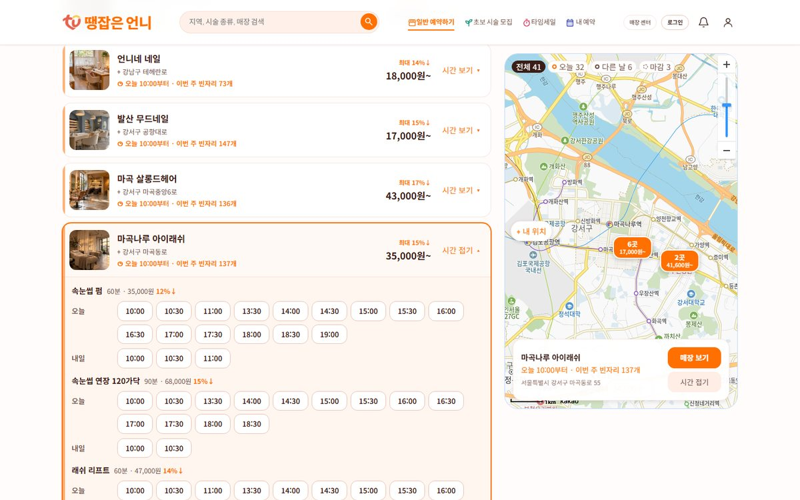
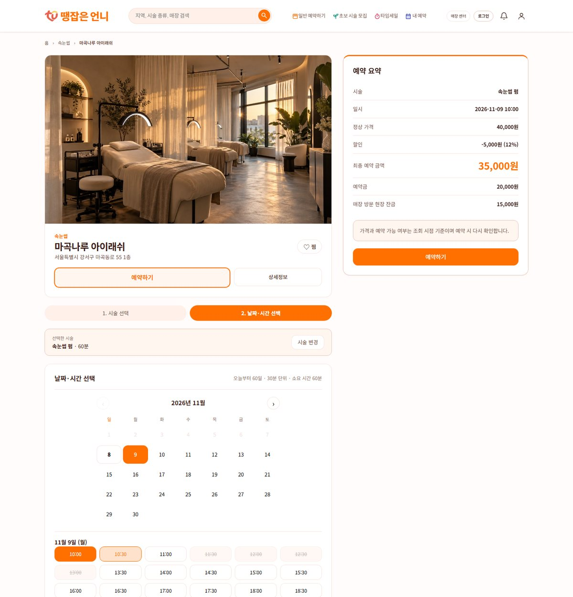
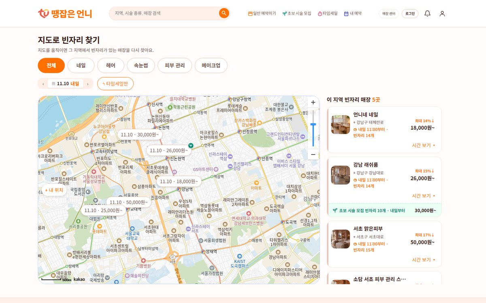
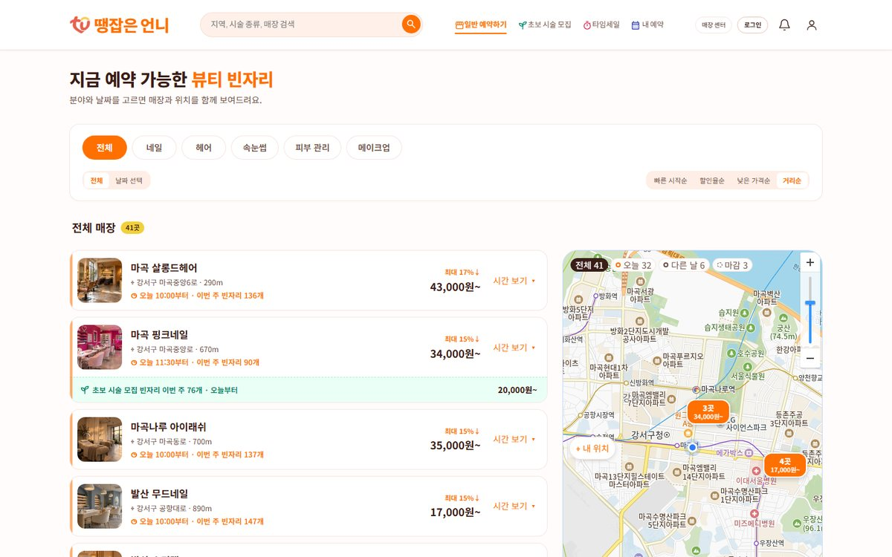
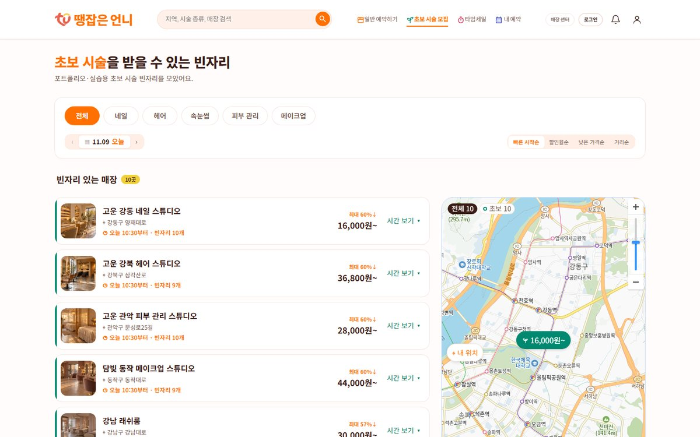
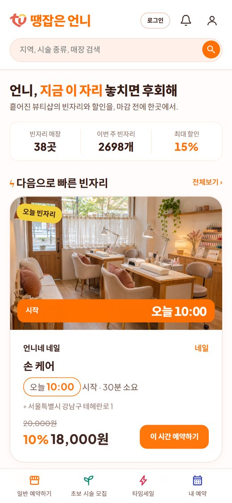
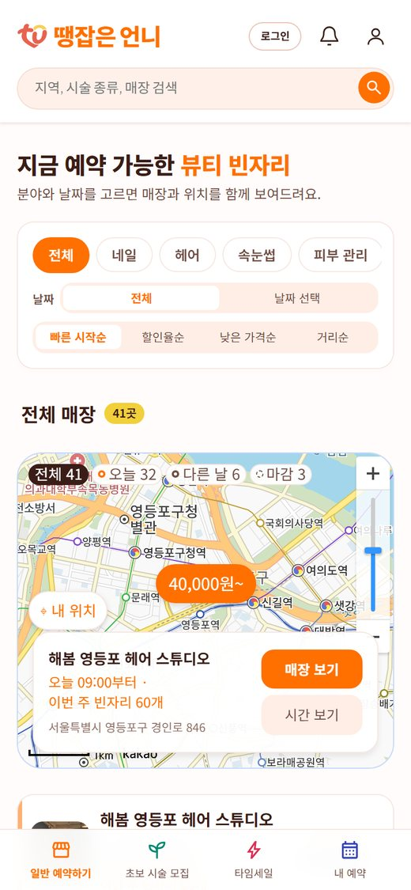
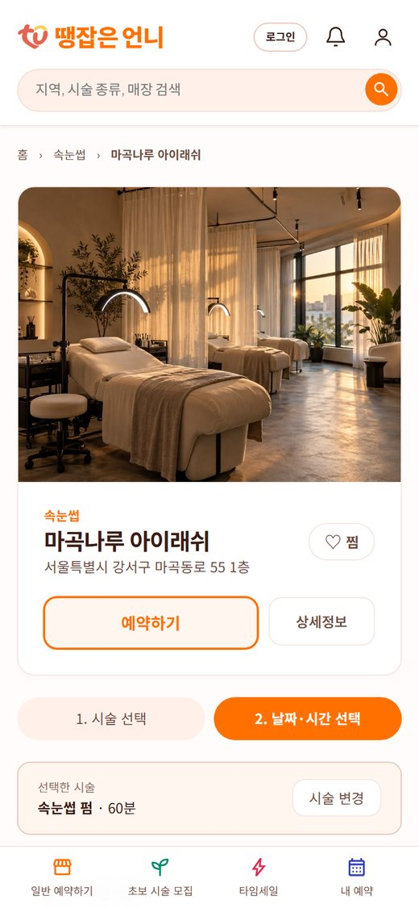
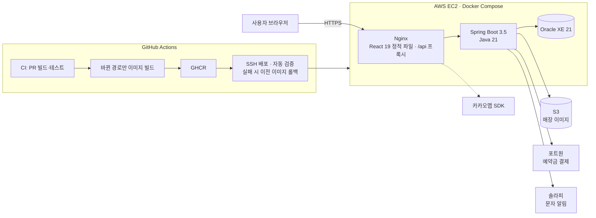

# 땡잡은 언니

> 흩어진 뷰티샵의 **취소·임박 빈자리**를 한곳에 모아, 시간이 다가올수록 할인된 가격에 바로 예약하는 플랫폼

[](https://thankunnie.shop)


| | |
|---|---|
| 과정 | LG CNS U-CAMP SW 개발자 과정 41기 (2026.09.01 – 11.06) 최종 팀 프로젝트 |
| 개발 기간 | 2026.10.20 – 11.06 (3주) |
| 인원 | 풀스택 6인 |
| 서비스 | [thankunnie.shop](https://thankunnie.shop) (테스트 결제 환경) |
| 원본 저장소 | [ironhamlab/thankunnie](https://github.com/ironhamlab/thankunnie) |

> 이 저장소는 백엔드 파트장 **박재현**의 포크입니다. 화면은 2026-11-09 배포 사이트에서 캡처했습니다.

<p align="center"></p>

## 목차

- [서비스 소개](#서비스-소개)
- [화면](#화면)
- [주요 기능과 정책](#주요-기능과-정책)
- [아키텍처](#아키텍처)
- [내가 맡은 부분](#내가-맡은-부분--백엔드-파트장-슬롯빈자리할인)
- [팀 구성](#팀-구성)
- [로컬 실행](#로컬-실행)
- [문서](#문서)

## 서비스 소개

네이버 예약 같은 일반 예약 플랫폼이 아니라 **"빈자리를 빨리 파는"** 서비스입니다.

- **고객**: 곧 시작하는 빈자리를 임박 순으로 보고, 할인된 가격에 바로 예약합니다. 예약금만 결제하고 잔금은 현장에서 냅니다.
- **매장**: 노쇼·취소로 비는 시간을 열어 두면, 시작이 가까워질수록 정해 둔 할인율로 가격이 내려가며 노출됩니다.
- **관리자**: 매장 입점 신청을 승인합니다.

## 화면

### 웹

| 일반 예약하기 — 시간 보기를 펼치면 가까운 두 날짜의 시작 시각 | 매장 상세 — 날짜·시간 선택과 예약 요약 |
|:---:|:---:|
|  |  |
| **지도로 빈자리 찾기 — 지도를 옮기면 그 지역을 다시 검색** | **거리순 — 내 위치에서 가까운 매장부터** |
|  |  |
| **초보 시술 모집 — 모델 할인 시술만 모아 보기** | |
|  | |

### 휴대폰

<p align="center">
  
  &nbsp;
  
  &nbsp;
  
</p>
<p align="center">홈 · 빈자리 목록과 지도 · 매장 상세</p>

## 주요 기능과 정책

| 영역 | 기능 |
|---|---|
| 탐색 | 분야·날짜·지역 검색, 빠른 시작순·할인율순·가격순·거리순 정렬, 카카오맵 핀, 홈 임박 캐러셀 (보는 동안 5초마다 갱신) |
| 가격 | 정상가 → 임박(시작 8~3시간 전) → 초임박(3시간~15분 전) 할인. 할인율은 매장이 시술별로 설정 |
| 예약 | 클릭 시 5분 점유하고 가격을 고정. 같은 빈자리에 여러 명이 몰리면 번호표 대기열로 한 명씩 |
| 결제 | 예약금 = min(할인가, 20,000원), 포트원 결제 (테스트 결제 환경) |
| 취소 | 이틀 전까지 전액 · 하루 전 50% · 당일 0원, 결제 후 10분 무료 취소(하루 1회), 취소된 시간은 바로 재공개 |
| 알림 | 매장·분야·지역 구독 시 임박·초임박·재공개 빈자리를 문자(솔라피)로 안내 |
| 매장 | 매장·시술·이미지 관리, 요일 영업시간, 특정 시간 열기·닫기, 예약·고객 관리, 대시보드 |

시간 정책은 모두 한국 시간 기준이며, 정책값은 `BookingPolicy` 한 클래스에 모여 있습니다.

| 기준 | 값 |
|---|---|
| 예약 클릭 마감 | 시작 20분 전 (결제 마감 15분 전 + 점유 5분) |
| 결제(접수) 마감 | 시작 15분 전 |
| 빈자리 등록 마감 | 시작 30분 전 |
| 예약 가능 기간 | 오늘 포함 60일, 30분 단위 |

## 아키텍처



| 영역 | 스택 |
|---|---|
| Back-end | Java 21, Spring Boot 3.5, Spring Data JPA, Gradle, JUnit 5, JaCoCo |
| Front-end | React 19, Vite, React Router, Zustand, Axios |
| DB | Oracle XE 21 (운영), H2 Oracle 모드 (개발·테스트) |
| Infra | AWS EC2 · S3, Docker Compose, Nginx, GitHub Actions, GHCR |
| 외부 | 포트원, 솔라피, 카카오맵, 국세청 사업자 확인 API |

## 내가 맡은 부분 — 백엔드 파트장, 슬롯·빈자리·할인

> 박재현 · [@parkJJae](https://github.com/parkJJae)

### 1. 슬롯을 저장하지 않는 가용 시간 모델

빈자리를 30분 슬롯 행으로 저장하지 않고, 요청마다 계산합니다.

```
가용 시간 = 영업시간 ∪ 시간대 열기 − 시간대 닫기 − 확정 예약 − 만료 전 결제 대기(HOLD)
```

- 예약을 취소하면 슬롯 상태를 되돌리는 작업 없이 바로 빈자리가 됩니다.
- 결제 대기는 상태가 아니라 **만료 시각**으로 판단해, 만료 스케줄러가 늦게 돌아도 판매에 영향이 없습니다.
- 탐색 화면은 여러 매장의 일정을 기간 단위로 한 번에 읽어 메모리에서 계산합니다. 매장·날짜마다 쿼리를 보내지 않고, Oracle IN 목록 제한(1,000개)에 맞춰 나눠 읽습니다.

### 2. 동시 예약 — 매장 단위 비관적 잠금

1인 매장이라 시술이 달라도 시간이 겹치면 함께 예약할 수 없습니다. 그래서 **매장을 경합 단위**로 잡았습니다.

```sql
-- ShopLock: 같은 매장의 시간을 바꾸는 작업을 줄 세운다
SELECT SHOP_ID FROM SHOP WHERE SHOP_ID = ? FOR UPDATE
-- 잠금 뒤 시각과 예약을 다시 읽어 검사하고, 같은 트랜잭션에서 저장한다
```

- 예약 점유, 시간대 열기·닫기, 영업시간 변경이 모두 같은 잠금을 씁니다.
- 잠금 순서를 회원 → 매장 → 예약 행으로 고정해 데드락을 막습니다.
- 잠금을 기다리는 사이 마감이 지나지 않도록 "지금 시각"도 잠금 뒤에 다시 구합니다.
- **왜 다른 방법이 아닌가**: 잠글 슬롯 행이 없어 `@Version`을 둘 곳이 없고, "시간 범위 겹침"은 유니크 키로 표현할 수 없습니다 (Oracle에는 EXCLUDE 제약이 없음).
- 결과: 같은 시간 10명 동시 예약 → 1명만 점유 (겹치는 시간·다른 시술도 동일, 10스레드 동시성 테스트 · H2 Oracle 모드)

### 3. 결제 대기를 마감으로 세던 문제

| | |
|---|---|
| Problem | 메인 "이번 주 빈자리"가 예약 클릭만으로 줄고, 결제 없이 풀리면 다시 늘어 숫자가 흔들렸습니다. |
| Root Cause | 집계가 결제 대기 구간을 확정 예약과 같은 "막힌 구간"으로 합쳐 계산했습니다. |
| Fix | 막힌 구간을 확정·닫힘 / 결제 대기로 나눠, 결제 대기로만 막힌 시각은 집계에 포함했습니다. 화면은 "다른 분이 결제 중"으로 표시하고 결제가 확정될 때만 마감을 안내합니다. |

### 4. 공통 기반과 테스트

- `ApiResponse`·`ErrorCode`·인증 stub·`BookingPolicy`·`Clock` 등 백엔드 공통 기반과 백엔드 컨벤션, AI 코딩 에이전트용 코드 형식 스킬 작성
- 현재 시각은 주입한 `Clock`으로만 구해, 마감·할인 경계를 고정 시계로 테스트
- 담당 도메인 테스트 커버리지 **Line 97.7% · Branch 91.8%** (팀 전체 Line 94.5%, 테스트 1,175개)
- `dev` 병합 PR 245건 중 52건

## 팀 구성

| 그룹 | 담당 | 영역 |
|---|---|---|
| A | 김명서 | 메인·매장·시술 관리, 공통 UI |
| B | **박재현** (백엔드 파트장) | 슬롯·빈자리·할인, 영업시간·열기/닫기·가용 시간, 백엔드 공통 |
| C | 홍인혜 | 탐색·지도·상세·결제 화면 |
| D | 김정현 | 예약 생성·점유·확정·대기열 |
| E | 김서원 (팀장) | 취소·환불, 배포 |
| F | 송승혁 | 알림 구독·임박 감지·문자·스케줄러 |

## 로컬 실행

```bash
# 백엔드 (H2, http://localhost:8080)
cd backend
./gradlew bootRun --args='--spring.profiles.active=local'

# 프론트엔드 (http://localhost:5173)
cd frontend
npm install
npm run dev
```

- 로컬 설정은 `backend/src/main/resources/application-local.yml.example`을 복사해 씁니다.
- 로컬 Oracle 확인이 필요하면 루트에서 `docker compose up -d` (Oracle Free, `localhost:1521/FREEPDB1`).

## 문서

- API 명세: [`docs/api`](docs/api)
- ERD·DDL: [`docs/erd`](docs/erd)
- 코드 컨벤션: [`docs/convention`](docs/convention)
- Git 협업 규칙: [`docs/git-guide.md`](docs/git-guide.md)
